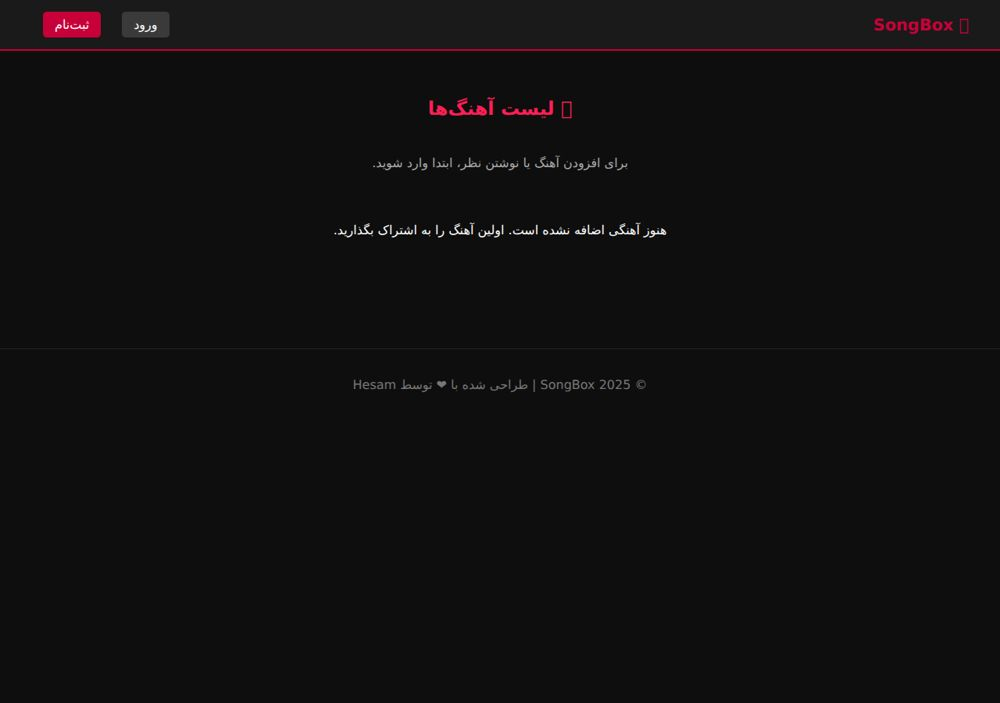

# CS50 SongApp



A Flask/SQLite music-sharing learning project with account registration, password hashing, song links, comments and a JSON songs endpoint.

## Run locally

Use Python 3.11+ from this repository folder:

```bash
python -m venv .venv
# Windows PowerShell:
.venv\Scripts\Activate.ps1
# macOS/Linux instead: source .venv/bin/activate
python -m pip install -r requirements.txt
python -m flask --app app init-db
python -m flask --app app run
```

Open http://127.0.0.1:5000. `init-db` creates missing tables without deleting existing data.

For a stable session key, set `FLASK_SECRET_KEY` in your shell to a long random value. PowerShell: `$env:FLASK_SECRET_KEY="your-random-value"`; Bash: `export FLASK_SECRET_KEY="your-random-value"`. `.env.example` documents the variable; `.env` is not automatically loaded. Without it, a random development key is generated per process and sessions expire on restart.

## Structure

- `app.py` — routes, SQLite connection lifecycle and `init-db` CLI
- `schema.sql` — non-destructive schema initialization
- `init_db.sql` — preserved original reset script; drops existing tables
- `templates/`, `static/` — Jinja templates, CSS and JavaScript
- `requirements.txt` — pinned dependencies
- `tests/` — isolated database integration tests
- `docs/` — provenance and review results

## Behavior

Register with a 3–80 character username and an 8–256 character password, then log in to add an HTTP(S) audio URL and comment on existing songs. The app stores links, not audio uploads. `/api/songs` lists songs and comments. SQLite data stays in local `songapp.db` and is excluded from Git.

## Validation

```bash
python -m unittest discover -s tests -v
```

See `docs/VALIDATION.md` for execution results. Forms use per-session CSRF tokens and POST logout. Login rate limiting and account recovery are not implemented; it needs further work before public hosting. Debug mode is off unless `FLASK_DEBUG=1` is explicitly set.

## Source preservation

The original source is retained in the import commit. Original file checksums are in `docs/ORIGINAL_FILES.sha256`. No repository-wide license grant has been added.
